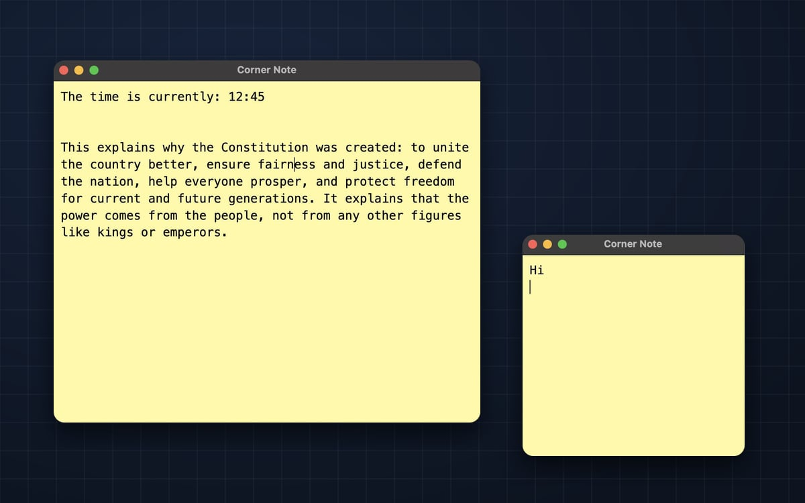

# Corner Note

A tiny sticky note that stays pinned to the corner of your screen, above every other window. It's for the one thing you need to keep in view while you work: a reminder, a reference, a half-finished thought.



## Download

Get the latest version from the [Releases page](../../releases/latest):

- **Mac with Apple silicon** (M1 or newer): `Corner-Note-x.y.z-arm64.dmg`
- **Mac with Intel**: `Corner-Note-x.y.z-x64.dmg`
- **Windows**: `Corner-Note-x.y.z-x64.exe`

The app isn't signed with an Apple developer certificate yet, so the first time you open it on a Mac, macOS will block it. Go to **System Settings**, open **Privacy & Security**, scroll down, and click **Open Anyway**. You only need to do this once.

## What it does

- **Always on top.** A small, resizable window that never hides behind other apps.
- **Saves as you type.** Your note saves a moment after you stop typing, and right away when you click off it or close the window. There's no save button.
- **Never loses your note.** Notes are stored in your computer's app data folder, so they survive restarts, crashes, and app updates. Each save is written completely before it replaces the old one, and the previous version is kept as a backup.
- **Undo big mistakes.** Deleted everything by accident? Right-click the note and choose **Restore an earlier version**. Corner Note keeps your last 100 versions: one every couple of minutes while you type, and one right before any big deletion.
- **Opens when you log in.** It's there when your computer starts, with no tray icon or extra clutter.

Your note lives at:

- macOS: `~/Library/Application Support/Corner Note/`
- Windows: `%APPDATA%\Corner Note\`

## Building it yourself

Requires Node.js 18 or newer.

```bash
npm install
npm start       # run it
npm run dist    # build an installer into dist/
```

To publish a new version, bump `version` in `package.json`, then open the **Actions** tab, choose **Build Corner Note**, and click **Run workflow**. GitHub builds the Mac and Windows installers and posts them on the Releases page.

## How it's built

Electron, with plain JavaScript, HTML and CSS.

- `index.js` opens the window, keeps it on top, and adds the right-click menu
- `storage.js` handles saving, backups, and version history
- `preload.js` is the small, safe bridge between the note and your disk
- `renderer.js` auto-saves as you type
